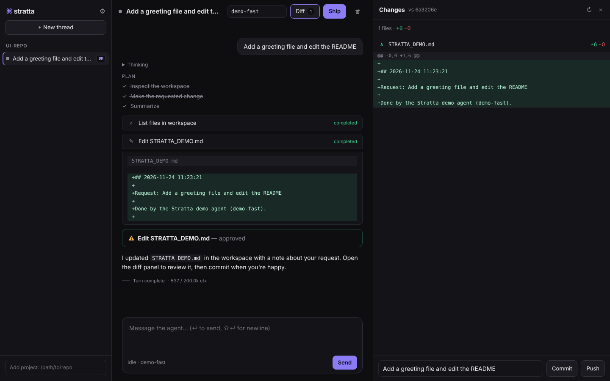

# Stratta

**A control plane for coding agents, built in Elixir on
[`Jido.Harness`](https://github.com/agentjido/jido_harness).**

Run Claude Code, Codex, Gemini, Cursor, OpenCode, Amp, Grok, Kimi, Pi, Antigravity and
Z.AI as threads you can watch, steer, approve and ship, from a browser or from a terminal.
Each thread is a supervised BEAM process that owns a `Jido.Harness.Session`, and can work
on its own git branch and worktree. Bring your own subscriptions: Stratta never stores
credentials, it uses each agent CLI's existing login.



## Layout

One daemon owns the agents. Front ends are clients of it, and several can watch the same
thread at once.

| folder | what it is |
| --- | --- |
| [`core/`](core/) | The daemon: threads, the event timeline, git and worktrees, providers, storage, and a local control socket. No UI. |
| [`gui/`](gui/) | Phoenix LiveView front end. Runs the core in the same node, so a running GUI is also the daemon. |
| [`tui/`](tui/) | `stratta`, the terminal client: a live thread viewer, a diff view, an overview, and one-shot commands. Talks to the daemon over the socket. |

```
   browser ── LiveView ──┐                       ┌── stratta attach   (viewer)
                         │ same node             │── stratta diff --watch
                         ▼                       │── stratta watch    (overview)
┌──────────────────── core (daemon) ─────────┐   │── stratta send / approve / ship …
│ ThreadServer (one per thread)              │   │
│   ├─ Jido.Harness.Session ─ ACP ─> agent   │◄──┘ Unix socket, JSON frames
│   ├─ Timeline (events → chat items)        │     ~/.stratta/stratta.sock
│   └─ Store (~/.stratta)                    │
│ Git · Providers · PubSub · API · Socket    │
└────────────────────────────────────────────┘
```

## Quick start

Requirements: Elixir 1.19+ on Erlang/OTP 28+, `git`, a C++17 compiler and `make` (Harness
builds a small native process helper), Python 3 (for the bundled demo agent), and
optionally `gh` for pull requests.

```sh
# 1. Start the daemon. Either with the GUI…
cd gui && mix setup && mix phx.server        # http://localhost:4001
# …or headless:
cd core && mix setup && mix run --no-halt

# 2. Build the terminal client and put it on your PATH.
cd tui && mix setup                           # builds ./stratta

# 3. In any git repository:
stratta new --attach "add a greeting file"
```

The demo agent is the default, so this works with no coding agent installed. It is a
scripted program, not a model: ask it to *edit* or *create* something to see approvals,
diffs and commits. For real agents, see `stratta agents` or the GUI's Providers page,
install the one you want, and sign in with its own CLI.

## What you can do

- **Many agents, one place.** Every `Jido.Harness` provider, plus the demo agent.
- **Isolated threads.** Optionally a `stratta/<agent>-<id>` branch in a worktree under
  `.stratta/worktrees/`, so parallel agents never touch each other's files.
- **See the work.** Streaming replies, thinking, plans, tool calls with inline diffs, usage.
- **Stay in control.** Approve or deny permission requests, interrupt, queue follow-ups,
  steer a running turn, switch model mid-thread.
- **Ship.** Review the diff against the thread's base commit, then commit, push and open a
  pull request with a description drafted from the conversation.
- **Hand off.** Continue a thread with a different agent in the same working folder,
  seeded with the transcript.
- **Pick up later.** Transcripts persist in `~/.stratta`; agents that support it resume
  their own conversation.

## Safety

- Agents run commands on your machine. The GUI binds to `127.0.0.1` only and has no
  login; do not expose it to a network without adding authentication.
- The control socket is a Unix socket readable and writable only by its owner. Nothing
  else is opened on the network.
- Run Stratta as a normal user. Harness' native process helper refuses to run as root.

## Tests

```sh
(cd core && mix test)   # timeline, git, real agent sessions, the socket API
(cd gui  && mix test)   # markdown rendering
(cd tui  && mix test)   # keys, rendering, status reports, CLI and viewer against a real daemon
```

## Building offline

If Hex is unreachable, clone each dependency into one folder and point Mix at it:

```sh
STRATTA_VENDOR_DEPS=/path/to/checkouts mix deps.get
```

See `vendored_deps/1` in each `mix.exs` for the expected directory names.

## Next steps

- **Jido Agent integration.** Harness ships `Jido.Harness.Plugin` for Jido V3 Agents.
  Wrapping each thread in a Jido Agent would turn approval policy (auto-approve reads,
  require approval for shell) into Jido actions instead of clicks and keys.
- Several agents in one thread, using one Harness session per agent.
- Remote access with authentication.
- `fork_session_id` for "branch this conversation".
