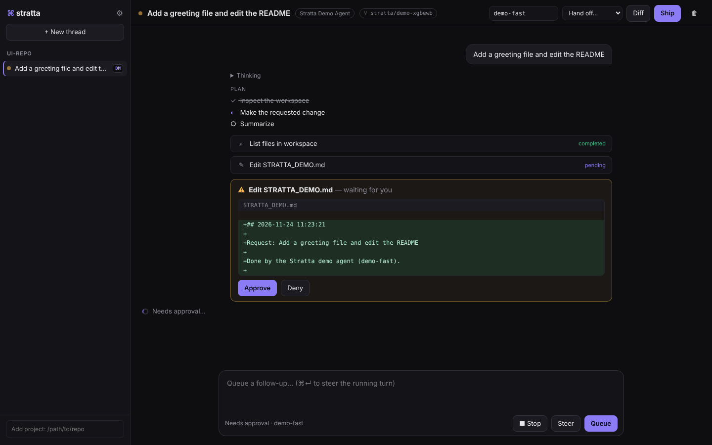
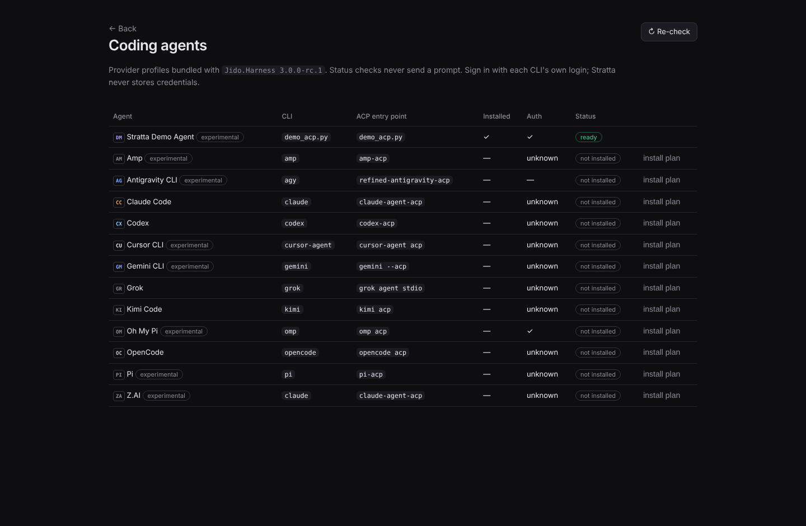

# Stratta GUI

The Phoenix LiveView front end. It runs the [core](../core/) in the same node, so a
running GUI is also the daemon the `stratta` terminal client talks to.

```sh
mix setup
mix phx.server          # http://localhost:4001
```



1. Paste a repo path into **Add project**.
2. Start a thread with **Stratta Demo Agent**. It works with nothing else installed. Ask
   it to *edit* or *create* something to see approvals, diffs and the ship flow.
3. For real agents, open **⚙ Providers**, follow the install plan
   (or `iex -S mix` → `Jido.Harness.install(:claude)`), then log in with the CLI itself
   (`claude`, `codex login`, …).

## What is here

| screen | does |
| --- | --- |
| Sidebar | projects and their threads, each with a live status dot |
| New thread | project, agent, model, approval and sandbox modes (only the options that agent accepts), optional worktree |
| Thread | streaming timeline with thinking, plans, tool calls and inline diffs; approve or deny; stop, queue or steer; switch model; hand off to another agent |
| Diff panel | tracked and untracked changes against the thread's base commit; commit and push |
| Ship panel | commit, push and open a pull request with a drafted title and body |
| Providers | install, sign-in and readiness of each agent, from `Jido.Harness.status/1` (no prompt is ever sent), with the dry-run install plan |



`StrattaWeb.AppLive` subscribes to the core's PubSub topics (`thread:<id>` and
`threads`) and renders the snapshots it receives; it holds no agent state of its own.
There is no JavaScript build step: `priv/static/assets/app.js` is two small hooks.

The server binds to `127.0.0.1` only and has no login. Agents can run commands on your
machine; do not expose this to a network without adding authentication.
